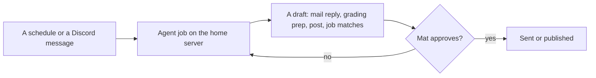

# Mat Niznik

Software engineer in Long Beach, CA. I put AI into real workflows and own the result: the model takes the first pass at scale, tests sit behind it, and a person makes the calls that carry real stakes.

Ten years shipping web and mobile in TypeScript, React, React Native, Node.js, Python, Flask, Django, PostgreSQL and AWS. I also teach programming at Bethesda University of California. Open to Forward Deployed and Applied AI engineering roles.

## What I run every day: MatOS

MatOS is my personal operating system, a set of AI agent jobs on a mini PC at home. As of November 2026 it runs 26 scheduled jobs (job search, school mail, grading prep, social posting). I build it with Claude Code, OpenAI Codex reviews the changes, and it has 1,060 automated tests. I run it from Discord and a phone dashboard, and nothing leaves the machine until I approve it.

The code stays private because it touches my students, my mail and my accounts. The parts that are useful to anyone else are public below.

## Projects

| Repo | What it shows |
| --- | --- |
| [ai-rubric-grader](https://github.com/mattniznik/ai-rubric-grader) | Claude grades a submission against a rubric under a strict JSON contract. Every grade stays a draft until a person approves it. |
| [agent-lanes](https://github.com/mattniznik/agent-lanes) | Rules that keep unattended AI agent runs safe with the Claude Code and Codex CLIs: fallback between them, deny rules, no task done twice, capped automatic fixes. |
| [job-radar](https://github.com/mattniznik/job-radar) | A config-driven job finder over public job boards. It sorts, scores and dedupes postings, flags sponsorship lines and stores every run in SQLite. [Live sample report](https://mattniznik.github.io/job-radar/sample-report.html). |
| [fact-locked-resume](https://github.com/mattniznik/fact-locked-resume) | An AI tailors a résumé by choosing facts by id from one YAML file. Anything it makes up is refused before a PDF is written. [Sample PDF](https://mattniznik.github.io/fact-locked-resume/sample-resume.pdf). |

Each one comes out of MatOS, with the personal parts taken out. They all have tests and CI.

## Elsewhere

- Portfolio: [mniznik.com](https://www.mniznik.com)
- LinkedIn: [linkedin.com/in/matniznik](https://www.linkedin.com/in/matniznik)
